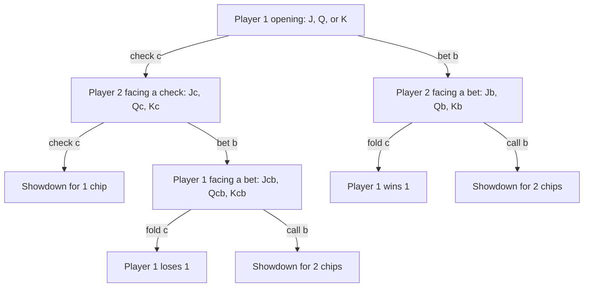
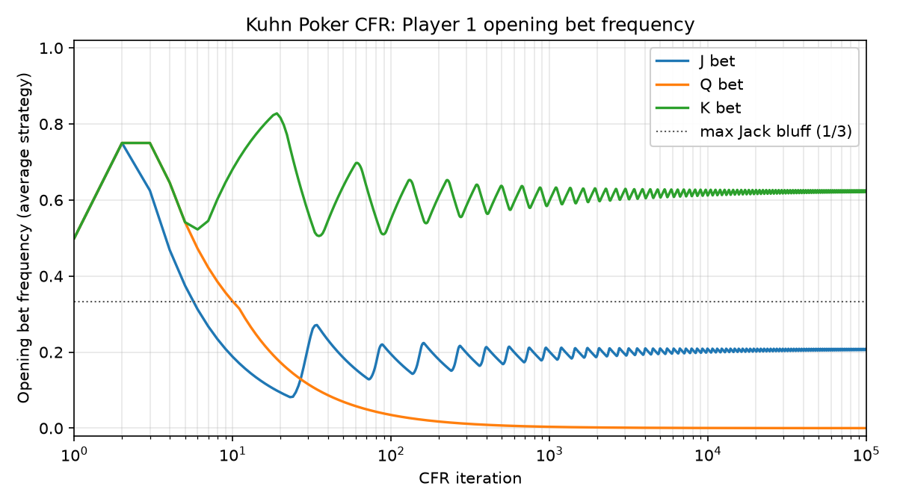

# NashLab

NashLab is a small lab for building game-theory solvers from scratch and checking them against known equilibria. The current project is 3-card Kuhn poker, solved with vanilla Counterfactual Regret Minimization (CFR).

The trainer lives in [`kuhn_cfr.py`](kuhn_cfr.py). Running it prints the learned strategy and writes [`convergence.png`](convergence.png). Importing the module does not start training, so a later interface can call `KuhnCFR` directly.

Update this file when a solver, a reported result, or the layout of the project changes.

## Current progress

As of 26 November 2026 the repo contains one solver and one result.

- Vanilla CFR for Kuhn poker, including the full 12-information-set tree, regret tables, exact expected value, a terminal report, and the convergence plot.
- A rules check: the known equilibria at bluff rates α = 0, 1/6, and 1/3 each evaluate to exactly −1/18 on this tree.
- A training run of 100,000 iterations. Player 1's value under the learned average strategy is −0.055555, against the Nash value −1/18 ≈ −0.055556.
- No interface yet. `KuhnCFR.train` is the entry point a later UI can call.

### Progress log

| Date | Change |
| --- | --- |
| 2026-11-26 | Added `kuhn_cfr.py` and the 100,000-iteration Kuhn poker result below. |

## Run it

The script needs Python, NumPy, and Matplotlib.

```bash
python -m pip install numpy matplotlib
python kuhn_cfr.py
```

That command retrains from a uniform strategy, prints the table, and overwrites `convergence.png`. The numbers in this README are from the run on 26 November 2026. Refresh them if the algorithm changes.

Use the class from another program:

```python
from kuhn_cfr import KuhnCFR

game = KuhnCFR()
game.train(100_000)
game.expected_value()          # Player 1's value of the average strategy
game.average_strategy("Kcb")   # array [fold probability, call probability]
game.plot_convergence()        # writes convergence.png
```

`opening_bet` has shape `(iterations, 3)` after training. The columns are Player 1's average-strategy opening bet rate with Jack, Queen, and King, recorded after every iteration.

## Kuhn poker

Harold Kuhn introduced this game in 1950 as a poker model small enough to solve on paper and rich enough to need bluffing. Two players ante 1 chip each. The deck is Jack < Queen < King. Each player is dealt one private card, and the third card is discarded unseen. There are 6 equally likely deals. Player 1 acts first. A bet is 1 chip. Raises are impossible, so each player acts at most twice.



The five finished betting sequences and Player 1's profit are:

| History | What happened | Player 1's profit |
| --- | --- | --- |
| `cc` | Both check. Higher card wins the ante. | +1 or −1 |
| `bc` | Player 1 bets, Player 2 folds. | +1 |
| `bb` | Player 1 bets, Player 2 calls. Higher card wins. | +2 or −2 |
| `cbc` | Player 1 checks, Player 2 bets, Player 1 folds. | −1 |
| `cbb` | Player 1 checks, Player 2 bets, Player 1 calls. Higher card wins. | +2 or −2 |

Player 2's profit is the negation of Player 1's on every hand. The game is zero-sum: every chip one player gains, the other loses. A showdown has no tie, because the two dealt ranks are always different.

The pot language matches those profits. Both players have already put in the ante. A fold wins that ante, worth 1 chip. A call puts in another chip from each player, so the winner of the showdown nets 2.

## Information sets

A player observes their own card and the betting so far. They do not observe the opponent's card. An **information set** is one of those distinguishable situations. The solver names each one with a string: the card, then the actions.

`c` means the passive action: check when nobody has bet, fold when a bet is facing the player. `b` means the aggressive action: bet, or call when a bet is facing the player. `"Kcb"` is Player 1 holding the King, having checked, now deciding whether to fold or call.

| Information set | Who acts | What they know |
| --- | --- | --- |
| `J`, `Q`, `K` | Player 1 | Their card. Nobody has bet. |
| `Jc`, `Qc`, `Kc` | Player 2 | Their card. Player 1 checked. |
| `Jb`, `Qb`, `Kb` | Player 2 | Their card. Player 1 bet. |
| `Jcb`, `Qcb`, `Kcb` | Player 1 | Their card. They checked, and Player 2 bet. |

There are 12 information sets because there are 3 cards and 4 decision points. Several deals share one information set. A player holding a Jack at the opening plays the same strategy whether the opponent has the Queen or the King, because the player cannot tell those deals apart. CFR's job is to learn one action distribution per string.

Inside the code, pass is action 0 and bet is action 1. The English word changes with the history, which is why the printed table says "Pass (Check/Fold)" and "Bet (Bet/Call)".

## Nash equilibrium

A **strategy** gives, at each of a player's information sets, a probability for every legal action. A pair of strategies is a **Nash equilibrium** when neither player can raise their own expected chips by switching to a different strategy while the opponent's strategy stays fixed.

In a two-player zero-sum game the equilibrium *value* is unique even when many strategy pairs achieve it. Kuhn showed that this value is

$$
-\frac{1}{18} \approx -0.055556
$$

chips per hand for Player 1. Player 1 is at a disadvantage because Player 2 sees how Player 1 acted before deciding whether to bet.

Player 1 has infinitely many equilibrium strategies. They are indexed by a bluff rate α in the interval [0, 1/3]:

| Situation | Jack | Queen | King |
| --- | --- | --- | --- |
| Player 1 opening bet | α | 0 | 3α |
| Player 1 facing a bet after checking | fold | call with α + 1/3 | call |
| Player 2 facing a check | bet 1/3 | check | bet |
| Player 2 facing a bet | fold | call 1/3 | call |

Player 2's equilibrium is unique. Every α in that interval, paired with Player 2's strategy, is an equilibrium, and every one of them is worth −1/18 to Player 1. CFR is free to settle on any α. The run below settled near α = 0.205.

### Why some actions are forced

A few actions are best no matter what the opponent does.

- With a King against a bet, calling wins the showdown and nets +2. Folding loses the ante and nets −1. Calling is better against every opposing hand.
- With a Jack against a bet, calling loses the showdown and nets −2. Folding loses only the ante. Folding is better against every opposing hand.
- With a King after the opponent checks, betting wins +1 if the opponent folds and +2 if the opponent calls. Checking wins +1 at showdown. Betting is always at least as good as checking.

The Queen is the interesting card. Calling a bet wins against a Jack and loses against a King, so the Queen should call only when enough of the opponent's bets are bluffs.

### Where 1/3 and 3α come from

The mixed probabilities are set by **indifference**: a player who is supposed to randomize must get the same expected value from each action in the mix. Otherwise that player would drop the worse action, and the opponent's bluff frequency would be exploitable.

Take Player 1 holding a Jack. Checking leads to −1 against Player 2's equilibrium. If Player 2 has the Queen, Player 2 checks behind and the Queen wins the ante. If Player 2 has the King, Player 2 bets and the Jack folds. Either way Player 1 loses 1.

Now suppose Player 1 instead bets the Jack, and Player 2 calls a Queen with probability $c$ and always calls a King. The opponent holds Queen or King with equal probability 1/2, so the value of the bluff is

$$
\frac{1}{2}(1 - 3c) - 1.
$$

The term $1 - 3c$ is the result against the Queen: a fold pays +1 and a call pays −2. The final −1 is the certain loss against the King, who always calls. Set the bluff equal to the check value of −1:

$$
\frac{1}{2}(1 - 3c) - 1 = -1 \quad\Rightarrow\quad c = \frac{1}{3}.
$$

So Player 2 calls one-third of Queens. At that call rate, Player 1 is willing to bluff a Jack at any rate α.

The factor of 3 on the King is what makes *Player 2* willing to call the Queen at a fixed rate. Conditional on holding a Queen and seeing a bet, Player 2's posterior odds are

$$
P(\text{Player 1 holds Jack}) : P(\text{Player 1 holds King}) = \alpha : 3\alpha = 1 : 3,
$$

provided α > 0. Calling then wins +2 against the Jack one quarter of the time and loses 2 against the King three quarters of the time:

$$
\frac{1}{4}(+2) + \frac{3}{4}(-2) = -1.
$$

Folding is also worth −1. The Queen is indifferent, so calling with probability 1/3 is a best response for every legal α. The upper bound α ≤ 1/3 is the requirement that the King's betting probability 3α stay at most 1. At α = 0, Player 1 never bets, the posterior above is unused, and the boundary strategy of always checking the King is still an equilibrium.

The same kind of indifference fixes the remaining entries, including Player 2's one-third Jack bluff after a check and Player 1's Queen call rate of α + 1/3. The trainer does not encode this table. It is the target the learned probabilities are compared with. For a chosen α, `nash_bet_target` in `kuhn_cfr.py` returns the bet/call column.

## Counterfactual regret minimization

CFR (Zinkevich, Johanson, Bowling, and Piccione, 2007) learns an equilibrium by self-play. Each information set keeps a score of how much it wishes it had played each action more often. The next strategy follows those wishes. In a two-player zero-sum game, the *average* of the strategies played across iterations approaches a Nash equilibrium.

### Regret matching

Let $R(I, a)$ be the cumulative regret of action $a$ at information set $I$. Write $R^+(I, a) = \max(R(I, a), 0)$. The strategy at that information set is

$$
\sigma(I, a) =
\begin{cases}
R^+(I, a) \big/ \sum_{a'} R^+(I, a') & \text{if the sum is positive,} \\
1/2 & \text{if both regrets are non-positive.}
\end{cases}
$$

A negative regret means the action has been worse than the strategy already used, so regret matching assigns it probability 0 until the regret climbs above zero. At the start every regret is 0, so the first strategy is 50/50 at every information set. That is why all three curves in the plot start at 1/2.

### Counterfactual regret

The regret added on one iteration is not the chips won on one played line. It is the difference between the value of taking an action and the value of the strategy currently used there, weighted by how the rest of the game reaches that decision.

For the acting player, the weight is the opponent's probability of playing to this point times the probability of the deal. In this solver every deal has probability 1/6, and both actions are visited explicitly, so the weight at a node is

$$
\frac{1}{6} \times (\text{opponent reach}).
$$

The acting player's own past action probabilities are left out of that product. The resulting number answers a specific question: if the player had taken this action at this information set, and the opponent had kept the same strategy, how much better or worse would the result have been? That is the **counterfactual** in the name.

At `"Kcb"`, for example, Player 1's reach is the probability of having checked the King. Player 2's reach is the probability of having bet after that check. The fold-versus-call regret uses Player 2's reach. It studies the decision itself. The contribution to the average strategy uses Player 1's reach, so a check that Player 1 almost never makes has little weight in the averaged behavior at `"Kcb"`.

Utilities in `cfr` are stored as Player 1's chips. Player 2's instantaneous regret is the negation of Player 1's action advantage, because Player 2's gain is Player 1's loss.

### The average strategy

The strategy that converges is the weighted average

$$
\bar\sigma(I, a)
= \frac{\sum_t \pi_i^t(I)\,\sigma^t(I, a)}{\sum_t \pi_i^t(I)}.
$$

Here $\pi_i^t(I)$ is the probability that player $i$, using the strategy from iteration $t$, played the earlier actions that reach $I$. The code stores the numerator in `strategy_sum` and normalizes it in `average_strategy`. The latest regret-matching strategy keeps moving from iteration to iteration. The plot records the average after each iteration, which is the object whose exploitability shrinks.

**Exploitability** is how many extra chips a best-responding opponent could take. Vanishing average regret implies vanishing exploitability in two-player zero-sum games, so the average strategy profile becomes an approximate Nash equilibrium. Its expected value must then sit close to −1/18. `expected_value` computes that number directly: it walks all 6 deals under the frozen average strategy and averages them with weight 1/6. It does not average the values of the intermediate strategies.

### One training iteration

`train` repeats the following for 100,000 iterations.

1. Build a strategy at all 12 information sets by regret matching on `regret_sum`. This strategy is frozen for the whole iteration.
2. Walk all 6 deals. At every decision, recurse down both `c` and `b`, accumulate counterfactual regret, and accumulate `my reach × strategy` into the average-strategy numerator.
3. Add those accumulators into `regret_sum` and `strategy_sum`, then store Player 1's opening bet rates.

Deals are enumerated in a fixed order and no action is sampled, so the same iteration count reproduces the same tables. Freezing the strategy matters: if regret were applied in the middle of the iteration, the second deal would be trained against a different strategy than the first.

## The 100,000-iteration result

Training took 10.2 seconds. Player 1's exact value under the learned average strategy:

| | Chips per hand |
| --- | ---: |
| Learned value | −0.055555 |
| Nash value, −1/18 | −0.055556 |
| Absolute error | 0.000001 |

The learned Jack opening bet is α = 0.2053, so the equilibrium King bet for that α is 3α = 0.6160. "Nash bet/call" is the equilibrium probability of the aggressive action at that α.

| Info set | Player | Situation | Pass | Bet / call | Nash bet/call |
| --- | --- | --- | ---: | ---: | ---: |
| `J` | 1 | Opening | 0.7947 | 0.2053 | 0.2053 |
| `Q` | 1 | Opening | 1.0000 | 0.0000 | 0.0000 |
| `K` | 1 | Opening | 0.3756 | 0.6244 | 0.6160 |
| `Jc` | 2 | Facing a check | 0.6643 | 0.3357 | 0.3333 |
| `Qc` | 2 | Facing a check | 1.0000 | 0.0000 | 0.0000 |
| `Kc` | 2 | Facing a check | 0.0000 | 1.0000 | 1.0000 |
| `Jb` | 2 | Facing a bet | 1.0000 | 0.0000 | 0.0000 |
| `Qb` | 2 | Facing a bet | 0.6666 | 0.3334 | 0.3333 |
| `Kb` | 2 | Facing a bet | 0.0000 | 1.0000 | 1.0000 |
| `Jcb` | 1 | Facing a bet after checking | 1.0000 | 0.0000 | 0.0000 |
| `Qcb` | 1 | Facing a bet after checking | 0.4588 | 0.5412 | 0.5387 |
| `Kcb` | 1 | Facing a bet after checking | 0.0000 | 1.0000 | 1.0000 |

Pass probabilities are printed to 4 decimals, so a few zeros in the table are small positive numbers. Queen's opening bet is 0.000035. Player 2's Jack bluff at `Jc` differs from 1/3 by 0.0023, and Player 2's Queen call at `Qb` differs from 1/3 by 0.00008.

The loosest entry is the King's opening bet, 0.6244 against a target of 0.6160. That gap is about how the algorithm picks one equilibrium out of the α family. The value of the strategy profile is already within $10^{-6}$ of −1/18, while the exact ratio "King bet = 3 × Jack bet" is still closing. Player 2's rows are tighter because that equilibrium strategy is unique.

Separately, the tree was evaluated with the theoretical strategies installed directly, at α = 0, α = 1/6, and α = 1/3. Each value matched −1/18 to machine precision. That check tests the payoffs and the traversal. The training run is what searches for the strategy.

## Reading the convergence plot



The horizontal axis is the CFR iteration on a logarithmic scale, from 1 to 100,000. The vertical axis is the probability, under the average strategy, that Player 1 opens with a bet. The dotted line at 1/3 is the largest equilibrium Jack bluff.

Early on, the average still contains the opening 50/50 strategy, and regret matching swings as actions cross between positive and negative regret. Those swings show up as waves in the Jack and King curves. The waves shrink because each new iteration is a smaller fraction of the cumulative average. By roughly 10,000 iterations the lines are flat:

- Queen falls to 0. An opening Queen bet is not part of any equilibrium.
- Jack settles near 0.205, inside (0, 1/3).
- King settles near 0.62, close to three times the Jack rate.

A log axis is there so the approach and the flat equilibrium are both visible. On a linear axis, almost the whole figure would be the flat region.

## Where the math lives in the code

| Idea | Where |
| --- | --- |
| Card ranks J=0, Q=1, K=2, and the six deals | `CARD_NAME`, `DEALS` |
| Passive action `c`, aggressive action `b` | `PASS`, `BET`, `ACTION_CHAR` |
| The 12 named situations, in tree order | `DECISION_POINTS` |
| Payoffs for `cc`, `bc`, `bb`, `cbc`, `cbb` | `_terminal_payoff` |
| Regret matching | `KuhnCFR._matched_strategies` |
| Counterfactual regret and the average-strategy sum | `KuhnCFR.cfr` |
| Frozen iteration over all six deals | `KuhnCFR.train` |
| Normalized average strategy | `KuhnCFR.average_strategy` |
| Exact value of that strategy | `KuhnCFR.expected_value` |
| Equilibrium bet/call probability for a chosen α | `nash_bet_target` |
| Terminal table and residuals | `KuhnCFR.print_summary` |
| The figure above | `KuhnCFR.plot_convergence` |

## References

- H. W. Kuhn, "A Simplified Two-Person Poker," *Contributions to the Theory of Games*, Vol. 1, 1950. The game, the α family, and the value −1/18.
- M. Zinkevich, M. Johanson, M. Bowling, and C. Piccione, "Regret Minimization in Games with Incomplete Information," *Advances in Neural Information Processing Systems*, 2007. Vanilla CFR, counterfactual regret, and convergence of the average strategy in two-player zero-sum games.
